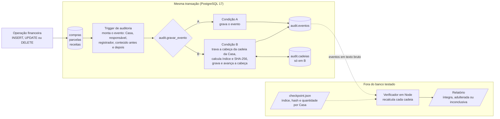
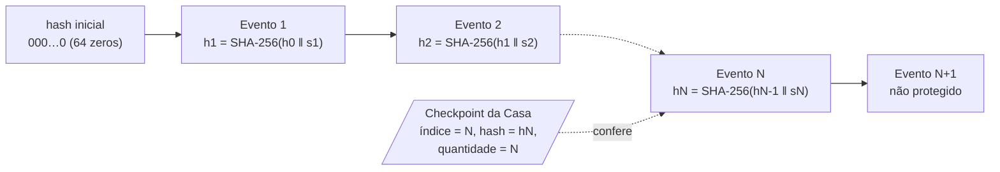
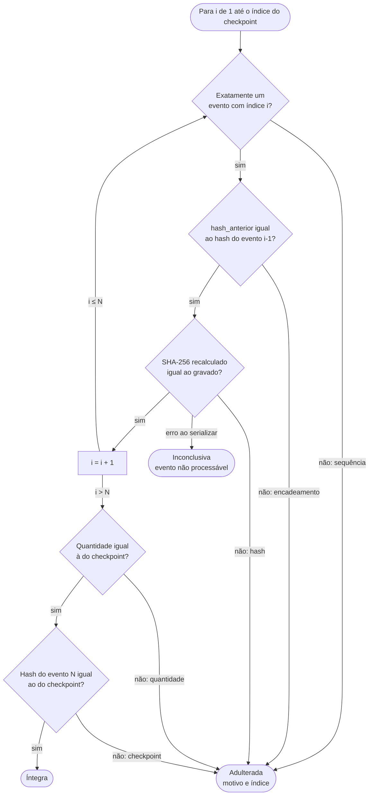

# Figuras e tabelas do experimento

Material para Material e Métodos e Resultados Preliminares (roteiro,
bloco 4). Os diagramas estão em Mermaid, que o GitHub e o VS Code
desenham. As imagens para o documento ficam em [figuras/](figuras/) (PNG em
2x com fundo branco e SVG), geradas com o `mermaid-cli` 11; ao mudar um
diagrama, gerar de novo. Os nomes de
objetos (`audit.eventos`, `audit.gravar_evento`...) são os do código, em
`sql/` e `src/`.

## Figura 1: arquitetura do mecanismo de auditoria

A operação financeira e o seu evento de auditoria são gravados na mesma
transação. Os triggers são iguais nas duas condições; só
`audit.gravar_evento` muda.

## Figura 2: cadeia de uma Casa e checkpoint

Cada evento incorpora o hash do anterior. O checkpoint, guardado fora do
banco, fixa o índice e o hash do último evento confirmado; eventos
posteriores a ele ainda não estão protegidos.

*s* = serialização canônica do evento (versão `v1`, Tabela 1); ‖ =
concatenação.

## Figura 3: verificação de uma Casa

## Tabela 1: modelo de evento auditável

Correspondência com o modelo do projeto aprovado ("identificador do
evento, operação, entidade afetada, pessoa responsável pelo fato
financeiro, usuário que registrou, timestamp e conteúdo necessário à
verificação").

| Campo | Tipo | Origem | No projeto aprovado | Entra no hash |
|---|---|---|---|---|
| (versão do formato) | texto fixo `v1` | constante da serialização | — | sim, 1º campo |
| `id` | `bigint` (identidade) | gerado pelo banco | identificador do evento | não (técnico; a ordem é o `indice`) |
| `casa_id` | `integer` | `casa_id` da linha; em parcelas, o da compra | — (define a cadeia) | sim |
| `indice` | `bigint` | B: último índice da Casa + 1; A: nulo | — (ordem na cadeia) | sim |
| `operacao` | `text` | operação do trigger (`INSERT`, `UPDATE`, `DELETE`) | operação | sim |
| `entidade` | `text` | tabela (`compras`, `parcelas`, `receitas`) | entidade afetada | sim |
| `entidade_id` | `bigint` | `id` da linha | entidade afetada | sim |
| `pessoa_responsavel_id` | `integer`, opcional | `pessoa_id` da linha ("Quem gastou"); em parcelas, o da compra | pessoa responsável | sim |
| `usuario_registrador_id` | `integer` | inclusão: `lancado_por_id` (reserva: `app.usuario_id`); parcelas: `app.usuario_id` (reserva: `lancado_por_id` da compra); alteração e exclusão: `app.usuario_id` | usuário que registrou | sim |
| `ocorrido_em` | `timestamptz` | `clock_timestamp()` | timestamp | sim, em UTC com 6 casas |
| `conteudo` | `jsonb` | `{"antes": linha antiga, "depois": linha nova}` | conteúdo necessário à verificação | sim, como texto do `jsonb` |
| `hash_anterior` | `char(64)` | B: hash do evento anterior (64 zeros no 1º); A: nulo | — | sim, como prefixo do cálculo |
| `hash` | `char(64)` | B: SHA-256(`hash_anterior` ‖ serialização); A: nulo | — | — (é o resultado) |

## Tabela 2: o que muda entre as condições

| | (A) Log convencional | (B) Log com hash chain |
|---|---|---|
| Trigger e montagem do evento | o mesmo | o mesmo |
| Persistência do evento, na mesma transação | sim | sim |
| Constraints (NOT NULL, FK, CHECK) | sim | sim |
| Índice na cadeia da Casa | não | sim |
| Bloqueio da cabeça da cadeia (`FOR UPDATE`) | não | sim, por Casa |
| Hash SHA-256 encadeado | não | sim |
| Checkpoint e verificação histórica | não | sim |

## Tabela 3: cenários de adulteração, esperado e obtido

"Obtido" vem dos testes funcionais do bloco 3 (`test/verificador.test.ts`),
com uma Casa de 5 eventos e o checkpoint criado antes do ataque. A
condição A não tem verificação histórica: o esperado é a não detecção,
exceto quando a adulteração violar uma constraint (por exemplo, um
responsável inexistente barrado pela FK). A coleta com volumes e
repetições é a do piloto.

| Cenário (projeto aprovado) | Variante testada | Esperado em A | Esperado em B | Obtido em B |
|---|---|---|---|---|
| Alteração de valor | valor de uma parcela | não detecta | detecta (`hash`) | detectado, `hash`, índice certo |
| Alteração de responsável | troca por outra pessoa existente | não detecta | detecta (`hash`) | detectado, `hash`, índice certo |
| Alteração de usuário registrador | troca por outra pessoa existente | não detecta | detecta (`hash`) | detectado, `hash`, índice certo |
| Alteração de timestamp | menos 1 dia | não detecta | detecta (`hash`) | detectado, `hash`, índice certo |
| Alteração de operação | troca para `DELETE` | não detecta | detecta (`hash`) | detectado, `hash`, índice certo |
| Exclusão | evento do meio | não detecta | detecta (`sequencia`) | detectado, `sequencia`, índice certo |
| Exclusão | último evento, com a cabeça ajustada | não detecta | detecta (`sequencia`) | detectado, `sequencia`, índice certo |
| Exclusão | todos os eventos da Casa | não detecta | detecta (`sequencia`) | detectado, `sequencia`, índice 1 |
| Inserção indevida | índice repetido (constraint derrubada) | não detecta | detecta (`sequencia`) | detectado, `sequencia`, índice certo |
| Inserção indevida | no meio, com renumeração e recálculo | não detecta | detecta (`checkpoint`) | detectado, `checkpoint`, sem localizar |
| Inserção indevida | depois do checkpoint | não detecta | **não detecta** (não protegido) | informado como não protegido |
| Alteração seguida do recálculo dos hashes posteriores | valor de uma parcela | não detecta | detecta (`checkpoint`) | detectado, `checkpoint`, sem localizar |

Leituras para o texto:

- Até o checkpoint, todas as variantes foram detectadas em B, sem falso
  positivo nas cadeias íntegras.
- Com recálculo dos hashes, só o checkpoint denuncia, e o evento
  alterado não é localizado.
- Inserções depois do checkpoint ficam fora da proteção, como o projeto
  já previa ("eventos depois do checkpoint não estão protegidos até o
  próximo").
